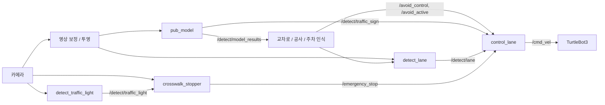

# TurtleBot3 자율주행 시뮬레이션

ROS 2와 Gazebo 기반의 카메라 자율주행 팀 프로젝트입니다. ROBOTIS TurtleBot3 AutoRace를 바탕으로 YOLO 표지판 인식 결과를 차선 추종 및 구간별 주행 동작에 연결했습니다.

**핵심 기술:** Python · ROS 2 · Gazebo · OpenCV · Ultralytics YOLO · 토픽 기반 주행 제어

## 프로젝트 소개

- 교육 과정: 두산로보틱스 지능형 로보틱스 엔지니어 K-Digital Training
- 팀: A-3 / AAA, 4인 팀 프로젝트
- 목표: 교차로, 공사 구간, 주차, 터널, 신호등이 있는 시뮬레이션 환경에서 인식과 주행 제어 통합
- 발표 자료: [프로젝트 발표](docs/presentation.pptx)

이 문서는 발표 자료와 현재 소스를 기준으로 작성했습니다. 주행 성공률·인식 정확도·완주 시간은 측정 자료가 없어 기재하지 않았습니다. 개인별 담당 범위는 아직 정리되지 않았으며, 아래 기능은 팀 결과물입니다.

## 주요 기능

| 기능 | 구현 방식 | 주요 코드 |
| --- | --- | --- |
| 표지판 인식 | 발표 자료 기준 YOLO11, 7개 클래스 검출 후 토픽 발행 | [pub_model.py](src/turtlebot3_autorace/turtlebot3_autorace_detect/turtlebot3_autorace_detect/pub_model.py) |
| 차선 추종·교차로 | 영상 기반 차선 검출, 표지판에 따른 차선 선택, PD 제어 | [detect_lane.py](src/turtlebot3_autorace/turtlebot3_autorace_detect/turtlebot3_autorace_detect/detect_lane.py), [control_lane.py](src/turtlebot3_autorace/turtlebot3_autorace_mission/turtlebot3_autorace_mission/control_lane.py) |
| 공사 구간 | 차선 상태·영상·오도메트리를 이용한 회피 동작 | [detect_construction_sign.py](src/turtlebot3_autorace/turtlebot3_autorace_detect/turtlebot3_autorace_detect/detect_construction_sign.py) |
| 주차 | 주차·정지 표지판과 영상 기반 회전·정지 동작 | [detect_parking_sign.py](src/turtlebot3_autorace/turtlebot3_autorace_detect/turtlebot3_autorace_detect/detect_parking_sign.py) |
| 터널 감속 | 입구 감지 후 감속, 타이머로 중복 감지 억제, 출구 감지 후 복귀 | [control_lane.py](src/turtlebot3_autorace/turtlebot3_autorace_mission/turtlebot3_autorace_mission/control_lane.py) |
| 신호등·횡단보도 | 색상 검출과 하단 영상의 흰색 윤곽선 검출을 조합해 정지 요청 | [crosswalk_stopper.py](src/turtlebot3_autorace/turtlebot3_autorace_mission/turtlebot3_autorace_mission/crosswalk_stopper.py) |

## 시스템 구성



## 문제 해결 과정

| 문제 | 접근 | 남은 과제 |
| --- | --- | --- |
| SIFT 기반 표지판 검출 불안정 | YOLO 기반 검출로 전환하고 confidence·박스 면적으로 결과 필터링 | 데이터셋 확장, 클래스별 정확도 측정 |
| 터널 입·출구 표지판 반복 감지 | 입구 이후 20초 대기, 출구 이후 10초 무시 구간 적용 | 고정 시간 대신 주행 상태를 반영한 판별 |
| 신호등·횡단보도 영상 인식 불안정 | 색상·픽셀 조건 및 영상 ROI 조정, 흰색 윤곽선 2개 이상 검출 | 조명별 임계값 검증, 하단 카메라 검토 |
| 주차 회전 직후 차선 중심값 불안정 | 주차 동작과 차선 인식 연계 | 회전 직후 노란 차선 재검출 안정화 |

## 저장소 구조

```text
src/
├── turtlebot3_autorace/      # 영상 처리, 표지판 인식, 미션 및 주행 제어
├── turtlebot3_simulations/   # Gazebo 모델, 월드, launch
├── turtlebot3/               # 로봇 설명, bringup, navigation 등 기반 패키지
├── turtlebot3_msgs/          # 메시지 정의
└── DynamixelSDK/             # ROBOTIS SDK
docs/                        # 발표 자료, 실행 및 공개 가이드, 출처
tools/                       # 중첩 Git 이력 없이 소스를 묶는 도구
```

## 실행 및 검증 상태

현재 확인 가능한 로컬 ROS 배포판은 Humble입니다. 프로젝트 당시 OS·의존성 버전은 별도로 고정되어 있지 않습니다. [실행 가이드](docs/RUNNING.md)에 빌드와 개별 노드 실행 예시, 재현에 필요한 누락 항목을 정리했습니다.

**현재 소스에는 `custom_track.world`가 참조하는 `custom_track` Gazebo 모델이 포함되어 있지 않습니다.** 따라서 원래 발표 환경의 전체 주행을 재현하려면 해당 모델을 추가해야 합니다. 이 정리 작업에서는 시뮬레이션 완주를 검증하지 않았습니다.

## 출처 및 공개

이 저장소는 ROBOTIS 오픈소스 기반의 팀 프로젝트입니다. 기반 패키지 전체를 팀이 직접 개발한 것으로 표시하지 않습니다. 각 디렉터리의 LICENSE와 저작권 표기를 유지하며, 기반 저장소·로컬 변경 파일은 [출처 기록](docs/UPSTREAM.md)을 참고하세요. 모델 가중치와 발표 자료의 사용 조건은 코드 라이선스와 별도로 확인해야 합니다.

GitHub에 올릴 소스 묶음 생성 및 업로드 절차는 [공개 가이드](docs/PUBLISHING.md)를 참고하세요.
